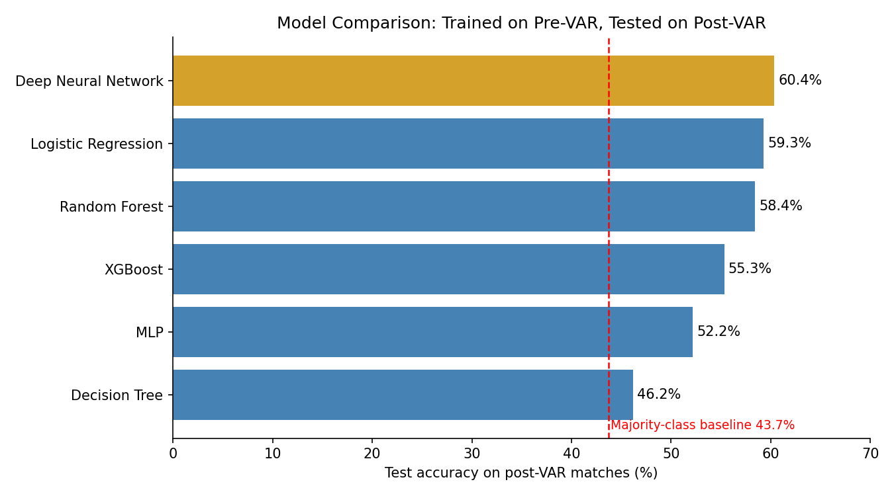
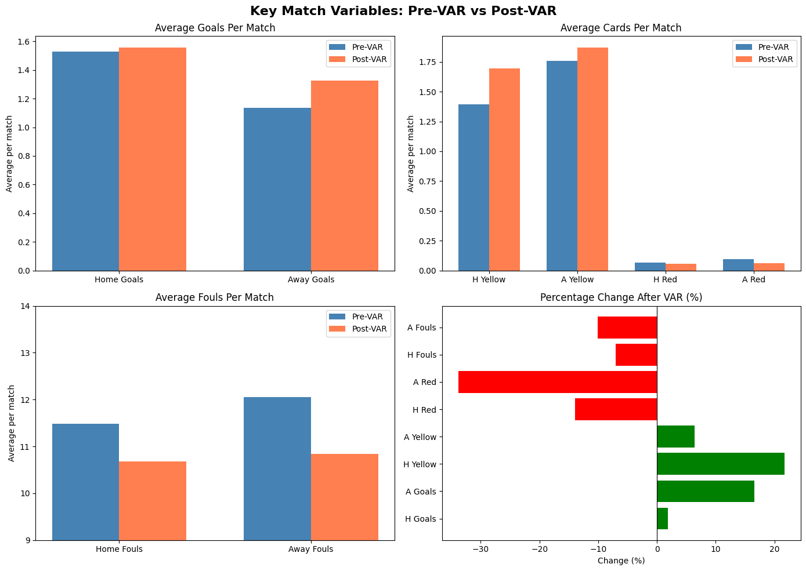
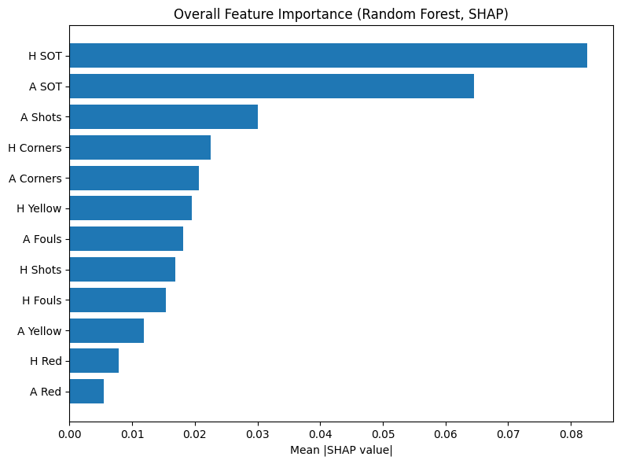

# Premier League Match Analysis: VAR and Machine Learning

An MSc Applied Data Science project exploring how Premier League match statistics and outcome-prediction performance differ before and after the introduction of Video Assistant Referee (VAR).

**Author:** Gbenga Shokunbi · **University:** University of Essex



## Project at a glance

- **9,329 matches** analysed across the 2000/01–2024/25 seasons.
- **12 in-match features:** home and away shots, shots on target, fouls, corners, yellow cards and red cards.
- **Six machine-learning approaches** compared, with a deep neural network achieving **60.36% test accuracy**.
- Statistical tests, regression models, robustness checks and SHAP interpretation used to examine patterns in the data.

> **Important interpretation:** This is an observational comparison. The results identify associations between the pre-/post-VAR periods; they do not establish that VAR caused the observed changes. The models use in-match statistics, so they are not pre-match forecasting tools.

## Research questions

1. How did selected match statistics differ between the pre-VAR and post-VAR periods?
2. How well did models trained on pre-VAR matches generalise to post-VAR matches?
3. Which in-match statistics were most influential in the model's predictions?

## Dataset and design

The project uses the Premier League portion of the [English Premier League & Championship dataset on Kaggle](https://www.kaggle.com/datasets/panaaaaa/english-premier-league-and-championship-full-dataset), credited to Joseph Buchdahl (12Xpert).

| Dataset stage | Matches / period |
|---|---|
| Raw Premier League data | 12,153 matches, 1993/94–2024/25 |
| Analysis dataset | 9,329 matches, 2000/01–2024/25 |
| Pre-VAR training period | 7,220 matches, 2000/01–2018/19 |
| Post-VAR test period | 2,109 matches, 2019/20–2024/25 |

Seasons before 2000/01 were excluded because key match-statistic fields were missing. The 2024/25 season is partial in the source data used for this analysis. The 2020/21 season is flagged for a separate COVID-related sensitivity check.

**The dataset is not included in this repository.** Download it from the source, review the source licence, and save the Premier League CSV as `Dataset1_Premier_League_1993_2024.csv`. The notebook looks for the file in the notebook folder or a `data/` subfolder; in Google Colab it can also prompt you to upload the file.

## Methods and tools

- Data cleaning and exploratory data analysis
- Welch's t-test and Mann–Whitney U test
- Negative Binomial regression and multinomial logistic regression
- Logistic Regression, Decision Tree, Random Forest, XGBoost, MLP and DNN
- Temporal evaluation: train on pre-VAR matches, test on post-VAR matches
- Robustness checks using a balanced recent-seasons window and a COVID-season exclusion
- SHAP feature interpretation

**Tools:** Python, pandas, NumPy, Matplotlib, Seaborn, SciPy, statsmodels, scikit-learn, XGBoost, TensorFlow/Keras, SHAP and Jupyter Notebook.

## Results

### Model performance

Models were trained on pre-VAR matches and evaluated on the post-VAR period.

| Model | Test accuracy | Weighted F1 | Pre-VAR 5-fold CV accuracy |
|---|---:|---:|---:|
| Majority-class baseline (always predict home win) | 43.7% | — | — |
| **Deep Neural Network** | **60.36%** | 0.549 | — |
| Logistic Regression | 59.27% | 0.541 | 55.83% |
| Random Forest | 58.42% | **0.554** | 53.95% |
| XGBoost | 55.33% | 0.540 | 52.70% |
| MLP | 52.16% | 0.508 | 49.10% |
| Decision Tree | 46.18% | 0.468 | 42.34% |

The DNN had the highest accuracy, while Random Forest had the highest weighted F1. Logistic Regression came within about one percentage point of the DNN's accuracy, so the more complex model did not provide a large accuracy gain.


### Match-statistic differences

The full-period Negative Binomial analysis reported statistically significant differences for six of the eight goal, card and foul measures shown below. These full-period patterns should be interpreted cautiously because football tactics, rules and other factors can change over time.

| Statistic | Pre-VAR mean | Post-VAR mean | Rate ratio | Significant |
|---|---:|---:|---:|---|
| Away goals | 1.137 | 1.325 | 1.166 | Yes |
| Home goals | 1.530 | 1.559 | 1.019 | No |
| Home yellow cards | 1.394 | 1.697 | 1.217 | Yes |
| Away yellow cards | 1.760 | 1.873 | 1.064 | Yes |
| Home red cards | 0.064 | 0.055 | 0.861 | No |
| Away red cards | 0.093 | 0.062 | 0.662 | Yes |
| Home fouls | 11.486 | 10.678 | 0.930 | Yes |
| Away fouls | 12.058 | 10.835 | 0.899 | Yes |



In the balanced recent-seasons check, away goals, away red cards and away fouls remained significant. Some full-period yellow-card and home-foul differences weakened or disappeared, suggesting longer-term trends may contribute to the overall differences.

### Feature interpretation

Shots on target were the most influential features in the SHAP analysis (home shots on target mean absolute SHAP value 0.083; away shots on target 0.065). SHAP values came from a 20-tree Random Forest using a 200-match post-VAR sample, so they explain that model rather than the DNN.



### Sensitivity checks

- **Balanced recent-seasons window:** pre-VAR seasons 2014/15–2018/19 compared with post-VAR seasons 2019/20–2023/24, with 1,900 matches in each period. Logistic Regression accuracy was 61.84%.
- **Excluding 2020/21:** reported accuracy was 59.22% for Logistic Regression, 58.18% for Random Forest and 55.35% for XGBoost, broadly similar to the full-period results.

## Run the notebook

### 1. Get the project

```bash
git clone https://github.com/shoks96/epl-var-machine-learning.git
cd epl-var-machine-learning
```

### 2. Create an environment and install dependencies

**Windows (PowerShell):**

```powershell
python -m venv .venv
.venv\Scripts\Activate.ps1
python -m pip install --upgrade pip
pip install -r requirements.txt
```

**macOS / Linux:**

```bash
python3 -m venv .venv
source .venv/bin/activate
python -m pip install --upgrade pip
pip install -r requirements.txt
```

### 3. Download the data

Download the Premier League dataset from the Kaggle source linked above. Save the file as `Dataset1_Premier_League_1993_2024.csv` in the project folder or inside a `data/` folder. The data file is intentionally not committed to this repository.

### 4. Open the notebook

```bash
jupyter notebook VAR_Dissertation_Analysis_Complete.ipynb
```

Run the cells from top to bottom. The notebook's loading cell checks the supported file locations and gives a clear message if the CSV cannot be found. Google Colab users can upload the file when prompted.

## Repository contents

- `VAR_Dissertation_Analysis_Complete.ipynb` — analysis, statistical testing, model evaluation and SHAP interpretation
- `model_comparison.png` — model-performance chart
- `match_statistics_pre_vs_post_var.png` — pre-/post-VAR comparison chart
- `shap_feature_importance.png` — SHAP feature-importance chart
- `requirements.txt` — Python dependencies

## Limitations

- The analysis is observational and cannot isolate a causal effect of VAR.
- The post-VAR test period includes a partial 2024/25 season.
- In-match features describe how a match unfolded; they would not be available for a prediction made before kick-off.
- The DNN result comes from a single trained model, and its accuracy advantage over Logistic Regression is small.
- Accuracy alone does not capture class-level performance; weighted F1 scores are around 0.55, and draws remain difficult to classify.

## What I learned

This project strengthened my skills in data preparation, statistical testing, machine-learning evaluation and communicating findings from a large real-world dataset. It also reinforced the importance of preventing target leakage and evaluating models on a later time period.

## Links

- [LinkedIn](https://www.linkedin.com/in/gbenga-shokunbi-25349994)
- [GitHub profile](https://github.com/shoks96)
